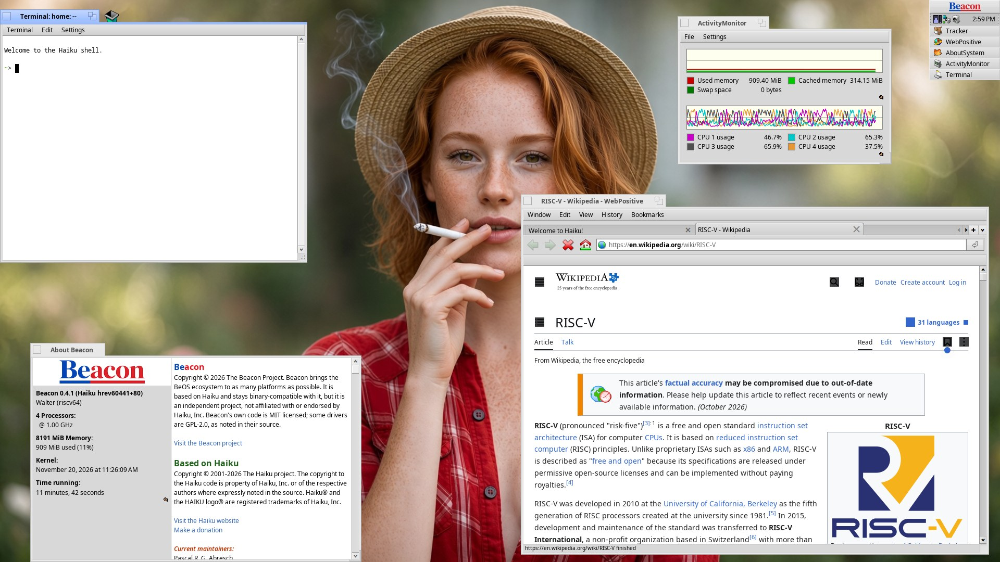
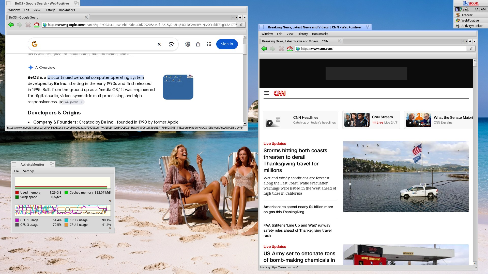
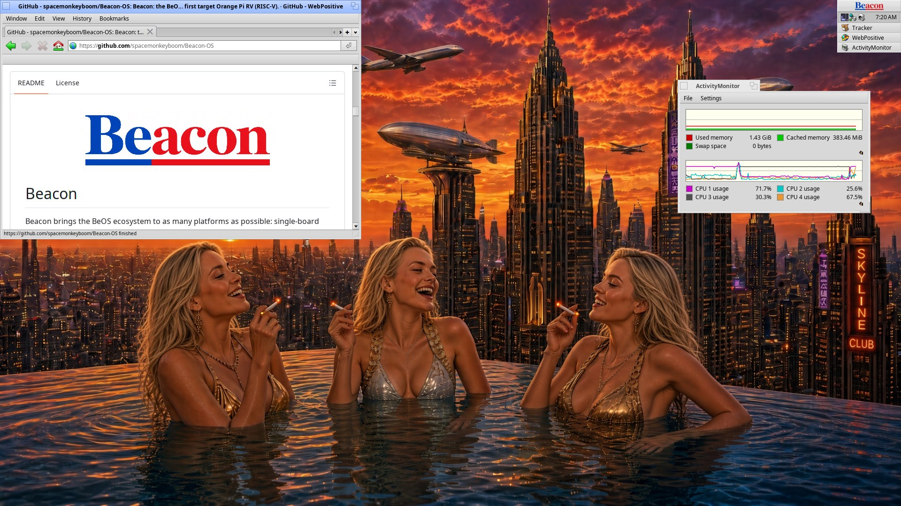
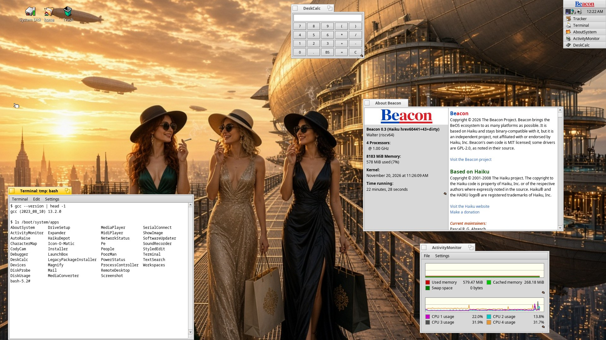
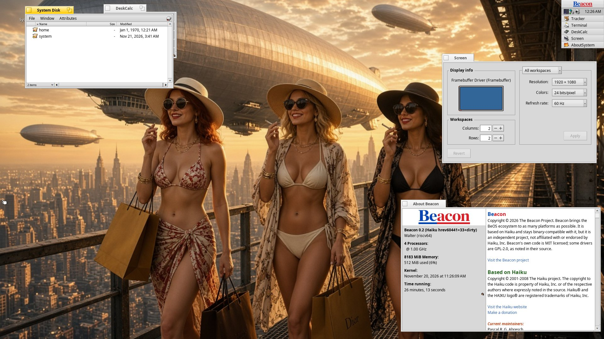

<!-- SPDX-License-Identifier: MIT -->
<p align="center"></p>

# Beacon

**Beacon** brings the BeOS ecosystem to as many platforms as possible:
single-board computers and odd hardware first. It is a fork of
[Haiku](https://www.haiku-os.org/) and stays binary-compatible with Haiku, so
Haiku and BeOS-style applications run unchanged.

Beacon is an independent project. It is based on Haiku's source code but is
**not affiliated with or endorsed by Haiku, Inc.** "Haiku" is a trademark of
Haiku, Inc.; it is used here only to describe where the code comes from.
RISC-V and the RISC-V logo (shown on the boot screen) are registered
trademarks of RISC-V International; Beacon is not affiliated with them.

Development is AI-assisted.

## 🎉 BEACON NOW RUNS ON THREE RISC-V BOARDS! 🎉

# ✅ Orange Pi RV  ✅ VisionFive 2  ✅ VisionFive 2 Lite

**November 26, 2026:** Beacon boots to the desktop on the **StarFive
VisionFive 2** and the **VisionFive 2 Lite**, as well as the **Orange Pi RV**.
**One SD card image** boots both StarFive boards and starts on its own, with
no changes to the boards' firmware. The VF2 Lite's on-chip USB controller got a
new Beacon driver the same day.

| Board | Status |
|---|---|
| Orange Pi RV (JH7110) | Desktop, USB, Wi-Fi, audio, WebPositive |
| VisionFive 2 (JH7110) | Desktop, USB keyboard and mouse |
| VisionFive 2 Lite (JH7110S) | Desktop, USB keyboard and mouse (new Cadence USB 3 driver) |

What it took: a boot partition the StarFive firmware finds by itself,
keeping the firmware's own memory out of the kernel's hands (the Lite's
firmware does not mark it reserved), and recognising the JH7110S. Details in
[docs/beacon/FINDINGS.md](docs/beacon/FINDINGS.md).

## 🦀 RUST RUNS ON RISC-V BEACON

Rust 1.100 now has a built-in `riscv64gc-unknown-haiku` target. The standard
library passes threads, files, networking and unwinding tests on the board.
This is the first step toward **Firefox on RISC-V Beacon**. See
[docs/beacon/rust](docs/beacon/rust).

## Screenshots

Beacon on an Orange Pi RV, November 26, 2026: WebPositive on Wikipedia, Terminal,
ActivityMonitor with all four cores busy, and About Beacon, over wallpaper 6
(AI-generated with Grok). Captured on the board itself:

<p align="center">
  
</p>

Beacon 0.4 running WebPositive on an Orange Pi RV (8 GB), captured on the board itself:

<p align="center">
  
</p>
<p align="center">
  
</p>
<p align="center">
  
</p>

Beacon 0.3:

<p align="center">
  
</p>

Beacon 0.2:

<p align="center">
  
</p>
<p align="center">
  
</p>

## First target: Orange Pi RV (StarFive JH7110, RISC-V)

| Area | Status |
|---|---|
| Boot from a single microSD card (vendor U-Boot, EFI) | Works |
| 4 CPU cores (U74), RAM | Works |
| HDMI desktop (1920x1080) | Works (display state carried over from U-Boot) |
| USB 3 ports (VIA VL805 over PCIe): keyboard, mouse, hot-plug | Works (VL805 fixes in the xHCI driver) |
| microSD card | Works (new `dw_mmc` driver, PIO) |
| Serial console (UART0, 115200 8N1) + kernel debugger | Works (Ctrl+] enters the debugger) |
| Wired Ethernet | In the image from 0.3 (new; please report results) |
| Wi-Fi (AP6256 / BCM43456 over SDIO) | Works: scan, WPA/WPA2, DHCP; stable under load from 0.3 (25 MHz SDIO, ~170 KB/s for now) |
| Full desktop: 37 apps, 22 preference panels; gcc 13, make, git and the Haiku headers on the board | Works (0.3) |
| Bluetooth | Planned |
| Audio: 3.5 mm jack and HDMI, switchable while playing (`audio_output`) | Works (some pops) |
| System sounds (Kenney "Interface Sounds", CC0) | Works |
| Web browser: WebPositive (HaikuWebKit 1.10.0, HTTPS) | Works (0.4.1); no JIT/WebGL yet. Packages for other Haiku riscv64 systems: see [Releases](https://github.com/spacemonkeyboom/Beacon-OS/releases) and [WEBKIT.md](docs/beacon/WEBKIT.md) |
| Qt 5 (Core, Gui, Widgets, Network) | Runs on the board (test app); see [QT5.md](docs/beacon/QT5.md) |
| Beacon's own Chromium-engine browser (Qt 6 WebEngine) | In progress: Qt 6, then QtWebEngine 6, then the browser |
| OpenGL (Mesa, software) and Vulkan | OpenGL built, testing; Vulkan planned |

**For other projects:** [docs/beacon/FINDINGS.md](docs/beacon/FINDINGS.md)
lists the bugs and hardware quirks we found (RISC-V TLB faults, VL805 USB,
SDIO, OpenBSD Wi-Fi driver on Haiku, Media Kit) and how we fixed them. Each
driver folder also has a README and a THIRD_PARTY.md.

Known issues:

* The first boot after flashing unpacks packages and takes a few minutes;
  `package_daemon` may show a crash dialog then (click *Terminate*).
* **Time zone at first login:** Beacon looks up a suggested time zone once,
  from your internet address, with one HTTPS request to ipapi.co, and asks
  you to confirm it or choose another. Nothing else is sent, and it does
  not run again.
* The desktop may be white for a moment at startup, with patches of the
  desktop colour where the mouse moves, until the wallpaper appears.
* Wi-Fi drops after being idle and does not reconnect by itself (0.4.1).
* Occasional kernel panic "Failed to acquire spinlock" (stale-TLB fault
  during an interrupt); a fix is in progress.
* Some keyboards with gaming "N-key rollover" reports may not type.
* The boot loader currently restores the HDMI pipeline from U-Boot's state;
  a proper display driver is planned.

## Try it

1. Download the latest image from
   [Releases](https://github.com/spacemonkeyboom/Beacon-OS/releases)
   and check its SHA-256.
2. Write it to a microSD card (2 GB or larger; **this erases the card**).

   **Windows** (easiest: no unpacking needed):
   * [Raspberry Pi Imager](https://www.raspberrypi.com/software/): *Choose
     Device* → "No filtering", *Choose OS* → **Use custom** → pick the
     `beacon-*.mmc.image.xz` file, *Choose Storage* → your microSD card →
     *Next* → "No" to OS customisation → *Yes* to write.
   * or [balenaEtcher](https://etcher.balena.io/): *Flash from file* → the
     `.xz` file → *Select target* → your card → *Flash!*
   * To check the download first, in PowerShell:
     `Get-FileHash .\beacon-0.3-orangepi-rv.mmc.image.xz` and compare it with the
     `.sha256` file.
   * Windows may offer to "format" the card afterwards: click **Cancel**. Windows
     cannot read Beacon's file system; that is normal.

   **macOS**: Raspberry Pi Imager or balenaEtcher, as above.

   **Linux**:

   ```
   xz -d beacon-*.mmc.image.xz
   sudo dd if=beacon-*.mmc.image of=/dev/disk/by-id/<your-card> bs=4M conv=fsync status=progress
   ```

   Use the card's `/dev/disk/by-id/...` name (`ls /dev/disk/by-id/ | grep mmc`)
   so you cannot write to the wrong disk. This erases the card.
3. Put the card in the Orange Pi RV, connect HDMI, a USB keyboard and mouse,
   and power on. The board's own U-Boot (in SPI flash) starts Beacon; nothing
   on the board is changed.

A USB serial adapter on the debug UART (115200 baud) shows the full boot log.
Please attach it to bug reports.

## Reporting bugs

Open an issue with: board and RAM size, image name, what you did, what you saw,
and the serial log if you have one. Security problems: please open an issue
marked **security** without exploit details and we will follow up.

## Building

Beacon builds like Haiku (see [ReadMe.Compiling.md](ReadMe.Compiling.md)).
For the Orange Pi RV image:

```
mkdir generated.riscv64 && cd generated.riscv64
../configure --cross-tools-source ../../buildtools --build-cross-tools riscv64 -j4
jam -q -j4 @nightly-mmc     # full image (0.4); @minimum-mmc for a small one
```

## Licences

Beacon's own code is MIT. Haiku's code keeps its licences (mostly MIT; see
[License.md](License.md) and the headers of each file). Some Beacon drivers
are adapted from Linux or U-Boot and are **GPL-2.0**; each such driver says so
in its headers and in a `THIRD_PARTY.md` next to it, for example
`src/add-ons/kernel/busses/pci/starfive/` and
`src/add-ons/kernel/drivers/network/ether/dwmac/`. The EFI boot loader's
JH7110 display bring-up (`BEACON_DC_REPLAY` in
`src/system/boot/platform/efi/arch/riscv64/arch_start.cpp`) replays a register
sequence taken from the vendor U-Boot (GPL-2.0+), so the riscv64 boot loader
binary is distributed under the GPL-2.0. Binaries built from GPL code are
distributed together with this complete source.

Haiku's original read-me is kept as [ReadMe.Haiku.md](ReadMe.Haiku.md).
